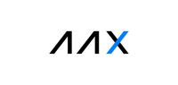
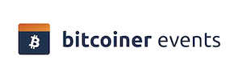

  <section class="jx-hero">
    

      

        
Introducing the

        <h1>BAHK App.</h1>
        
Your membership and benefits, finally in one place.

        

          <a class="jx-btn" href="https://members.bitcoin.org.hk/join">Apply to join</a>
          <a class="jx-btn jx-btn-ghost" href="https://members.bitcoin.org.hk/join/existing">Already a member? Register</a>
        

        
Members log in at <a href="https://members.bitcoin.org.hk/login">members.bitcoin.org.hk</a>

      

      
    

  </section>

  <section class="jx-sec">
    <h3>What you get</h3>
    
Join the people building Bitcoin in Hong Kong since 2012.

    

      
<svg viewBox="0 0 24 24" fill="none" stroke="currentColor" stroke-width="1.8" stroke-linecap="round" stroke-linejoin="round" aria-hidden="true"><rect x="2.5" y="5" width="19" height="14" rx="2.5"/><path d="M6 15h5"/></svg><h4>Your member card</h4>
In the BAHK App. Show it to get member prices.

      
<svg viewBox="0 0 24 24" fill="none" stroke="currentColor" stroke-width="1.8" stroke-linecap="round" stroke-linejoin="round" aria-hidden="true"><path d="M3 12.5V4a1 1 0 0 1 1-1h8.5l8.8 8.8a1.4 1.4 0 0 1 0 2l-7.5 7.5a1.4 1.4 0 0 1-2 0z"/><circle cx="8" cy="8" r="1.6"/></svg><h4>18+ discounts</h4>
Restaurants, hotels, shops and services across Hong Kong. More coming soon.

      
<svg viewBox="0 0 24 24" fill="none" stroke="currentColor" stroke-width="1.8" stroke-linecap="round" stroke-linejoin="round" aria-hidden="true"><path d="M12 3v3M5.5 9h13l-1 12h-11z"/><path d="M9 9V7.5a3 3 0 0 1 6 0V9"/></svg><h4>Christmas dinner</h4>
Included with your membership every year.

      
<svg viewBox="0 0 24 24" fill="none" stroke="currentColor" stroke-width="1.8" stroke-linecap="round" stroke-linejoin="round" aria-hidden="true"><rect x="3" y="5" width="18" height="16" rx="2.5"/><path d="M3 10h18M8 3v4M16 3v4"/></svg><h4>Events</h4>
Monthly meetups, classes and members-only events.

      
<svg viewBox="0 0 24 24" fill="none" stroke="currentColor" stroke-width="1.8" stroke-linecap="round" stroke-linejoin="round" aria-hidden="true"><rect x="4" y="3.5" width="16" height="17" rx="2.5"/><path d="M8 8.5h8M8 12h8M8 15.5h5"/></svg><h4>Classifieds</h4>
Buy and sell with other members.

      
<svg viewBox="0 0 24 24" fill="none" stroke="currentColor" stroke-width="1.8" stroke-linecap="round" stroke-linejoin="round" aria-hidden="true"><path d="M4 12.5l5 5L20 6.5"/></svg><h4>A vote</h4>
Voting rights in the association.

    

  </section>

  <section class="jx-sec" id="join-member">
    <h3>Membership</h3>
    
Open to everyone with a connection to Hong Kong and an interest in Bitcoin.

    

      

        
Individual

        
HK$1,500 a year

        
Christmas dinner included. Paid in bitcoin.

        <a class="jx-btn" href="https://members.bitcoin.org.hk/join">Apply to join</a>
      

      

        
Under 27

        
HK$888 a year

        
Christmas dinner included. Paid in bitcoin.

        <a class="jx-btn" href="https://members.bitcoin.org.hk/join">Apply to join</a>
      

    

    
Benefits are for members whose annual fee is paid up to date. A company? Email <a href="mailto:info@bitcoin.org.hk">info@bitcoin.org.hk</a>.

  </section>

  <section class="jx-sec" id="how-to-join">
    <h3>How to join</h3>
    
It all happens in the BAHK App.

    <ol class="jx-steps">
      <li>1<h4>Apply in the BAHK App</h4>
Tell us about yourself.
</li>
      <li>2<h4>Two member referrals</h4>
Name two members who know you.
</li>
      <li>3<h4>Pay in bitcoin</h4>
In the app. Once approved, your card is ready. If not, we refund you.
</li>
    </ol>
    

      

        <h4>Already a member?</h4>
        
Register in the BAHK App to get your card. Renew there each year, between 1 October and 9 December.

      

      <a class="jx-btn" href="https://members.bitcoin.org.hk/join/existing">Register</a>
    

  </section>

  <section class="jx-sec" id="member-discounts">
    <h3>Member discounts</h3>
    
Show your card in the BAHK App and save at these places. Many give you a better deal when you pay in bitcoin.

    <ul class="jx-places">
      <li>21M Digital Marketing</li>
      <li>AEM Crypto Software</li>
      <li>AirBTC</li>
      <li>Aki Hotel and Novotel</li>
      <li>Bankole, crypto law adviser</li>
      <li>BitGo</li>
      <li>Charlie Banana</li>
      <li>Frank's Restaurant and Bar</li>
      <li>Montaj Tailors</li>
      <li>ORM Korean Restaurant</li>
      <li>Santorini Grill</li>
      <li>Santorini Steakhouse</li>
      <li>Tree House Restaurants</li>
      <li>Whale Lounge</li>
    </ul>
    
See each deal in the BAHK App. More are coming soon. Want to offer a discount to members? Email <a href="mailto:info@bitcoin.org.hk">info@bitcoin.org.hk</a>.

  </section>

  <section class="jx-sec jx-faq">
    <h3>Questions</h3>
      

Who can join?

Anyone with a connection to Hong Kong and an interest in Bitcoin.

      

How do I pay?

In bitcoin, in the BAHK App.

      

When do I renew?

Once a year, between 1 October and 9 December. Your renewal includes the Christmas dinner.

      

Who gets the benefits?

Members whose annual fee is paid up to date: the card, discounts, Christmas dinner and classifieds.

      

What if I am not approved?

We refund your fee.

      

Can a company join?

Yes. Email <a href="mailto:info@bitcoin.org.hk">info@bitcoin.org.hk</a> and we will set it up with you.

  </section>

  

    <h3>Our Network</h3>
    

      

        Corporate members
      

      

        Partner Organizations
      

      

        Media
      

    

    

      

      	
      	
	
	
	
	
	
	
	
	
	
	
	
  	
      

      

	
	
	
	
     
      

      

	
	
	
	
	
	
  
  
      

    

    <a href="/members/" class="nbtn">Members</a>
  

